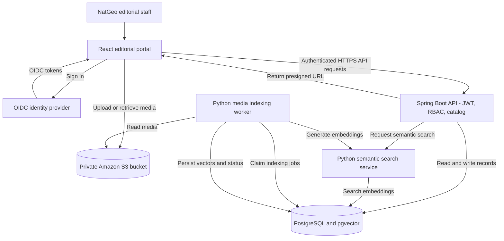
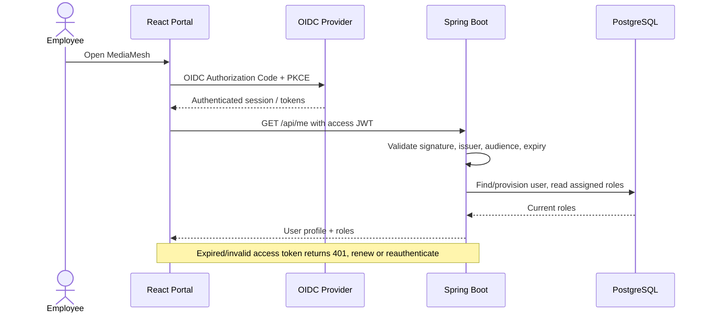
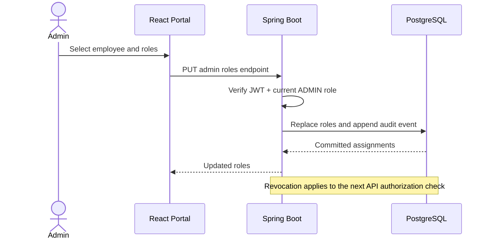
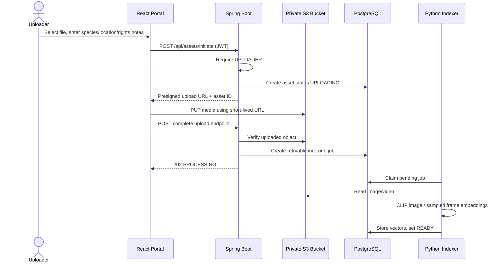
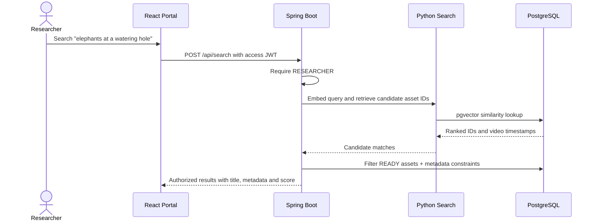
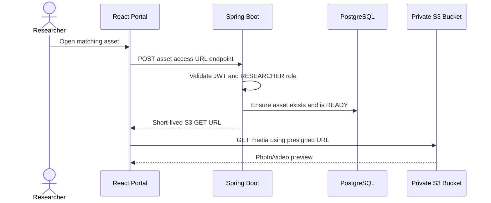

# MediaMesh — Enterprise Media Discovery for National Geographic

> **Status:** Design-approved candidate / implementation not started.  
> **Context:** CMPE 272 student project. National Geographic is a **hypothetical enterprise customer scenario**; this is not an official NatGeo product or integration.

MediaMesh is a secure, searchable media library for editorial teams. A wildlife photographer or archive assistant can upload photographs and documentary clips to private object storage. A footage researcher can then search using natural language—without knowing filenames—and retrieve authorized photos or approximate matching video moments. A media administrator decides who can upload and who can search.

**Example:** A researcher preparing a feature on elephants searches for **“elephants drinking at a watering hole at sunset.”** MediaMesh finds visually similar photographs and sampled frames from documentary clips, and displays uploader-provided species, location, capture date, contributor and usage notes.

## MVP at a glance

| Capability | Scope |
|---|---|
| Enterprise authentication | OIDC single sign-on; JWT-protected Spring Boot APIs; defined access/session expiration |
| Admin-controlled RBAC | `ADMIN`, `UPLOADER`, `RESEARCHER` roles; role changes checked against current DB assignments |
| Media catalog | Photo and short video uploads; editorial metadata; processing states |
| Media storage | Private Amazon S3 bucket; short-lived presigned URLs for upload and access |
| Natural-language discovery | CLIP text/image embedding similarity; video search using sampled keyframes |
| Vector retrieval | PostgreSQL + pgvector; authorized, ready assets only |
| Recommendation | Basic related-media suggestions from vector similarity (no behavioral personalization) |
| Delivery | React frontend, Spring Boot API, Python ML service, Docker Compose, Jenkins CI |

**Explicitly out of scope for MVP:** custom distributed storage/replication, Kubernetes, Kafka/SQS, service mesh, LLM agent/MCP, native audio search/transcription, multi-tenant SaaS, comprehensive digital-rights clearance, per-collection confidential-content ACLs. Media rights notes are advisory; they do not authorize publication.

## System architecture



**Security boundary:** The browser never accesses internal Python endpoints directly. The backend validates JWTs and verifies current role assignments for each protected action. S3 objects are private. Presigned URLs are scoped and short-lived; role revocation cannot invalidate an already-issued URL before it expires.

## User roles

| Action | ADMIN | UPLOADER | RESEARCHER | Signed-in unassigned |
|---|:---:|:---:|:---:|:---:|
| Assign or revoke roles | Yes | No | No | No |
| Upload photos/video | Only with UPLOADER role | Yes | No | No |
| Edit own asset metadata | Only with UPLOADER role | Yes | No | No |
| Search media | Only with RESEARCHER role | No | Yes | No |
| Preview / download | Only with RESEARCHER role | No | Yes | No |

Roles can be combined. On first SSO login, an employee is provisioned without application roles. The team must configure a controlled first-admin bootstrap process.

## Core workflows

### 1. Employee sign-in



### 2. Admin assigns access



### 3. Uploader adds wildlife footage



### 4. Researcher searches by natural language



### 5. Authorized preview/download



## Technology stack

| Layer | Chosen MVP stack | Notes |
|---|---|---|
| Web UI | React | Role-aware editorial portal |
| Enterprise API | Java / Spring Boot / Spring Security | JWT and RBAC enforcement, asset catalog, orchestration |
| SSO | OIDC provider (to finalize) | Keycloak for local testing or enterprise OIDC-compatible IdP |
| Media storage | Amazon S3 | Private object bucket; signed upload/download |
| Structured database | PostgreSQL | Users, roles, assets, indexing jobs, audit events |
| Vector database | pgvector | Vectors in the existing PostgreSQL database |
| ML retrieval | Python / Flask, Sentence Transformers / CLIP | Adapt relevant code from REEL-FINDER |
| Video indexing | FFmpeg | Sample keyframes, report approximate matching timestamp |
| Local development | Docker Compose | Service reproducibility, not production orchestration |
| CI | Jenkins + GitHub | Build, unit and integration tests |

## Repo organization

```text
Media-Mesh/
├── README.md
├── docs/
│   ├── design/                 # NatGeo stakeholder architecture and design background
│   ├── team/                   # Shared plan plus four individual task assignments
│   └── contracts/              # Contract freeze and integration guidance
├── backend/                    # Teammates 1 and 2: separate Java packages
├── ml-service/                 # Teammate 3: embedding, indexing and retrieval
├── frontend/                   # Teammate 4: React portal
├── infra/                      # Teammate 4: local/deployment definitions
└── Jenkinsfile                 # Added when CI is implemented
```

**This repository initially contains design and task documents, not a working application.** Source-code directories are placeholders for implementation; setup/build commands will be documented by each owner when their component exists.

## Team ownership

| Teammate | Exclusive responsibility | Task document |
|---|---|---|
| 1 | Enterprise identity, JWT, RBAC, admin APIs, audit | [Identity & RBAC](docs/team/01_PERSON_1_IDENTITY_RBAC.md) |
| 2 | Media catalog, metadata APIs, S3, indexing job lifecycle | [Media Backend & S3](docs/team/02_PERSON_2_MEDIA_S3_BACKEND.md) |
| 3 | CLIP embeddings, retrieval, video keyframes, pgvector integration | [ML & Search](docs/team/03_PERSON_3_ML_RETRIEVAL.md) |
| 4 | React portal, local orchestration, Jenkins, integration demo | [Frontend & DevOps](docs/team/04_PERSON_4_FRONTEND_DEVOPS.md) |

Start with the [shared team overview and API contracts](docs/team/00_TEAM_OVERVIEW.md). Shared interface changes require a PR review before modifying another person's owned code.

## Project documentation

- [NatGeo stakeholder system design](docs/design/NATGEO_STAKEHOLDER_DESIGN.md) — detailed use case, exact metadata, decisions, five sequence flows.
- [Enterprise design background](docs/design/ENTERPRISE_DESIGN_BACKGROUND.md) — prior design rationale and alternatives.
- [Team work allocation](docs/team/00_TEAM_OVERVIEW.md) — ownership rules, routes, sample request/response payloads, checkpoints.
- [Integration guidelines](docs/contracts/README.md) — source ownership and contract freeze checklist.

## Acceptance demonstration

1. Employee signs in using OIDC and initially has no permissions.
2. Administrator grants `UPLOADER` and/or `RESEARCHER` role; revocation works without relying on stale JWT role claims.
3. Uploader sends a NatGeo-style wildlife photograph and a short documentary clip to private S3 and supplies source metadata.
4. Indexing transitions from `UPLOADING` → `PROCESSING` → `READY`; duplicate completion does not double-index content.
5. Researcher searches **“elephants drinking at a watering hole at sunset”** and finds relevant images or video frames.
6. Researcher can preview/download authorized assets through short-lived URLs.
7. A user without permission receives `403`; an expired or invalid token receives `401`.
8. Docker local setup and Jenkins test pipeline are documented and demonstrable.

## Pending design decisions

- Final OIDC provider for the demo (Keycloak or federated hosted identity).
- AWS account, bucket name/region, billing limits, and mock strategy for CI.
- Exact CLIP model/version and embedding dimensions.
- Supported image/video formats and maximum upload sizes.
- Controlled bootstrap of first ADMIN account.

## Security and project hygiene

Never commit secrets, JWTs, OAuth credentials, AWS access keys, private S3 objects, user records or trained model/data caches. Use environment variables and example configuration only. Upload rights notes are not a substitute for formal media licensing checks.
