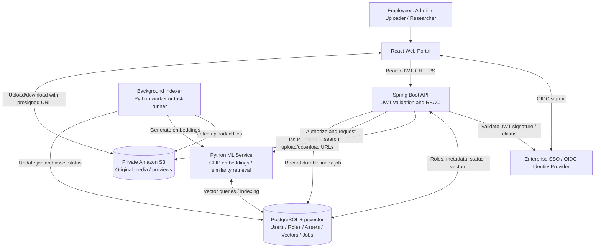
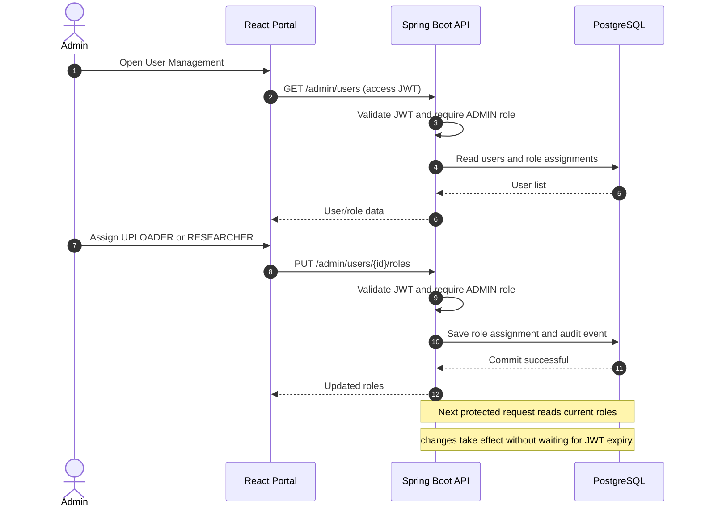
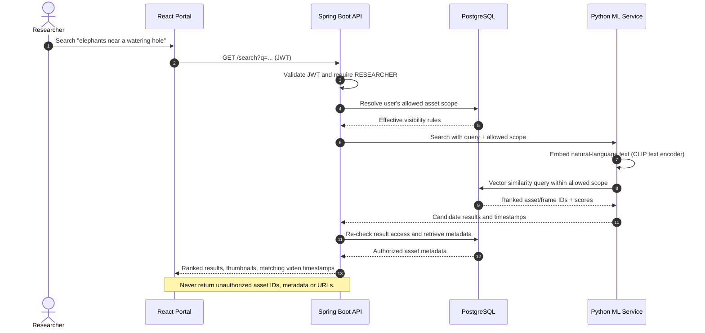
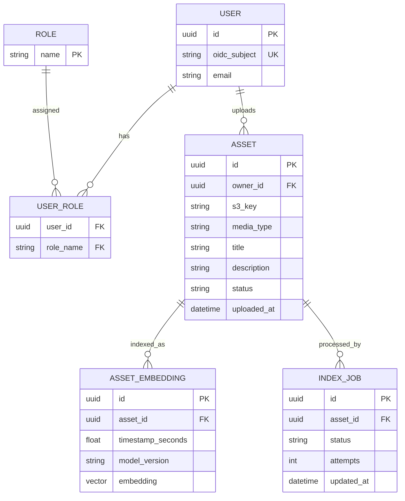

# MediaMesh — Enterprise Media Discovery Platform

**Solution design proposal | Stakeholder review | Version 0.1 | 7 November 2026**  
**Illustrative organization:** National Geographic (NatGeo-style use case; not an actual NatGeo integration)  
**Status:** Proposed architecture — decisions pending

## 1. Executive summary

MediaMesh is a secure internal media library where authorized employees upload photographs and videos, while authorized researchers use natural-language queries to locate relevant assets. An administrator assigns application roles. Employees authenticate through enterprise single sign-on (SSO); APIs validate JWT access tokens and enforce role-based access control (RBAC). Original files are held privately in Amazon S3. Metadata and vector embeddings are stored in PostgreSQL with pgvector. A Python ML service, adapted from the existing REEL-FINDER recommendation engine, provides semantic retrieval.

**MVP objective:** Demonstrate one complete, secure enterprise workflow: **SSO → admin role assignment → authorized media upload → automatic indexing → authorized semantic search → secure preview/download**.

The goal is **minimum implementation effort**, not a custom distributed storage system or a broad AI platform. S3 provides managed object storage; no custom replication, Kafka, Kubernetes, service mesh, or agent framework is required for the MVP.

## 2. Business problem and expected outcome

**Example scenario.** A NatGeo media researcher needs pictures or clips showing “elephants walking near a watering hole.” Searching filenames and manually maintained tags is slow and misses relevant assets. MediaMesh retrieves visually similar content while enforcing the permissions assigned by an administrator.

**Business outcomes:**
- Reduce time spent finding relevant visual media.
- Centralize access to approved media and ownership metadata.
- Ensure only permitted employees can upload, search, preview and download assets.
- Provide a clear path from upload to searchable asset, including failure status and retry.

**Primary users:** Administrator, Media Uploader, Media Researcher. A single employee may hold more than one role. Users with no assigned role may authenticate but cannot use protected business operations.

## 3. MVP scope and explicit exclusions

| In scope (required for demo) | Out of scope (defer unless approved) |
|---|---|
| Federated OIDC SSO and JWT-protected API | Building a custom identity provider |
| Admin-managed Uploader/Researcher roles | Complex organization-wide IAM workflows |
| Private S3 uploads, previews and downloads | Custom distributed file replication |
| Image semantic search with CLIP-compatible text/image embeddings | LLM agents, Ollama, MCP workflow orchestration |
| Video search through selected keyframes and timestamps | Native temporal video-understanding model |
| Asset metadata, status and access rules in PostgreSQL | Multi-tenant SaaS and elaborate per-asset ACL policy engine |
| Content-similarity recommendation (“Related media”) | Personalized collaborative filtering |
| Basic health checks, error handling and CI tests | Kafka, Kubernetes and service mesh |

**Audio:** Audio may be stored as a file, but semantic *audio-content* search is not guaranteed in the MVP. Uploaded title/description metadata can be searched. Transcription or audio embeddings are an optional extension.

**Authorization choice for minimum effort:** Roles control operations globally. Restrict access to assets by owner/collection visibility only if a restricted-collection demonstration is a stakeholder requirement. Otherwise start with a single internal media library where all Researcher-role users can view approved assets.

## 4. Proposed logical system architecture



**Deployment interpretation:** These are logical responsibilities, not necessarily separate microservices. The ML inference code and indexing worker may run from the same Python codebase. React, Spring Boot, Python and PostgreSQL can run in Docker Compose locally; S3 and the SSO provider are managed external services.

### Component responsibilities

| Component | Owns | Does not own |
|---|---|---|
| Identity provider | Employee authentication, SSO, OIDC protocol, token issuance | MediaMesh roles and media authorization |
| React portal | Login redirect, upload and search UI, result presentation | Security enforcement |
| Spring Boot API | JWT validation, role checks, asset lifecycle, presigned URLs, result authorization | Large binary file transfer or ML inference |
| PostgreSQL + pgvector | User-role assignments, media metadata, processing jobs, vectors | Original media bytes |
| S3 | Private object storage, managed durability | Semantic similarity search |
| Python ML | Image/text embedding, keyframe processing, vector similarity, related items | Assigning user roles |

## 5. Roles and access model

| Action | Admin | Uploader | Researcher | Unassigned employee |
|---|:---:|:---:|:---:|:---:|
| View/manage user-role assignments | Yes | No | No | No |
| Upload media | Optional* | Yes | No | No |
| Edit own media metadata | Optional* | Yes | No | No |
| Search media | Optional* | No | Yes | No |
| Preview/download search results | Optional* | No | Yes | No |

*For least privilege, **Admin is not implicitly a content user**. An admin can explicitly assign themselves Uploader or Researcher roles if needed. The table intentionally keeps administrative powers separate from content operations.

**Access rule:** Every protected API endpoint validates identity *and* current effective roles. UI visibility is convenience only. Role assignment/revocation persists in the application database and is checked for every request, so a long-lived JWT containing old roles does not override a revocation. JWT contains identity and standard security claims; application roles remain authoritative in PostgreSQL.

## 6. Primary sequence diagrams

### Flow A — Employee SSO login, JWT APIs and session expiry

```mermaid
sequenceDiagram
    autonumber
    actor Employee
    participant Web as React Portal
    participant IdP as OIDC SSO Provider
    participant API as Spring Boot API
    participant DB as PostgreSQL
    Employee->>Web: Open MediaMesh and select Sign In
    Web->>IdP: Authorization code flow with PKCE
    IdP->>Employee: Authenticate through enterprise SSO
    Employee->>IdP: Complete sign-in
    IdP-->>Web: Authorization code
    Web->>IdP: Exchange code securely for tokens
    IdP-->>Web: ID/access tokens and expiry
    Web->>API: GET /me with access JWT
    API->>API: Validate signature, issuer, audience, expiry
    API->>DB: Load current roles by identity subject
    DB-->>API: Assigned roles
    API-->>Web: Identity and authorized capabilities
    Note over Web,IdP: Token/session expiry controlled by IdP and app settings
    alt Access token expires; refresh is permitted
        Web->>IdP: Renew using supported secure session mechanism
        IdP-->>Web: New short-lived access token
    else Renewal not available / session expired
        Web->>Employee: Require SSO reauthentication
    end
```

**Security decisions:** OIDC Authorization Code + PKCE for the browser application; short-lived access JWTs; signature, `iss`, `aud`, and `exp` validation in Spring Security; protected tokens not stored in localStorage. Preferred implementation is a BFF/secure HttpOnly cookie or the identity provider's documented secure SPA flow. Application logout clears local session and requests IdP logout as supported. A locally cached JWT cannot automatically be revoked everywhere, so keep it short-lived and check RBAC against the database.

### Flow B — Administrator assigns or revokes a role



**Failure behavior:** A user without `ADMIN` gets HTTP `403`. Missing/expired/invalid JWT gets HTTP `401`. Admin cannot grant arbitrary unsupported role names.

### Flow C — Media upload and semantic indexing

```mermaid
sequenceDiagram
    autonumber
    actor Uploader
    participant Web as React Portal
    participant API as Spring Boot API
    participant DB as PostgreSQL
    participant S3 as Private S3
    participant Worker as Indexing Worker
    participant ML as Python ML Service
    Uploader->>Web: Select image/video and enter metadata
    Web->>API: POST /assets/upload-request (JWT, file metadata)
    API->>API: Validate JWT and require UPLOADER
    API->>DB: Create asset with UPLOADING status
    API-->>Web: Asset ID + short-lived S3 upload URL
    Web->>S3: Upload bytes directly via presigned URL
    S3-->>Web: Upload success
    Web->>API: POST /assets/{id}/complete (JWT)
    API->>S3: Verify object exists / expected type and size
    API->>DB: Commit asset PROCESSING + durable indexing job
    API-->>Web: Accepted; status PROCESSING
    Worker->>DB: Claim next pending indexing job
    Worker->>S3: Read asset (private service credentials)
    opt Video
        Worker->>Worker: Extract sampled frames and timestamps
    end
    Worker->>ML: Generate CLIP image/frame embeddings
    ML-->>Worker: Embeddings
    Worker->>DB: Upsert vectors; mark asset READY and job complete
    Web->>API: GET /assets/{id}/status (JWT)
    API-->>Web: READY
    alt Processing fails
        Worker->>DB: Record failure and retry count
        Note over Worker,DB: Bounded retry; status FAILED after limit
    end
```

**Reliability choice:** A minimal **database-backed indexing job**, not a volatile in-process callback, prevents lost work after restart without introducing SQS. Each job is idempotent by asset ID + model version. Support manual retry for `FAILED` assets. Set file-type/size limits, use private buckets and reject unexpected content.

### Flow D — Authorized natural-language semantic search



**MVP retrieval:** CLIP-compatible text and image embeddings are in the same space. Images have one or more vectors; videos are indexed using a limited number of keyframes. The existing REEL-FINDER request/embedding/similarity/ranking structure is reused, but movie-specific scoring, data files and MiniLM embeddings must be replaced or adapted. A user can request **related media** by searching with the chosen asset's embedding.

### Flow E — Authorized preview/download, expiration and denial

```mermaid
sequenceDiagram
    autonumber
    actor Researcher
    participant Web as React Portal
    participant API as Spring Boot API
    participant DB as PostgreSQL
    participant S3 as Private S3
    Researcher->>Web: Open a search result
    Web->>API: POST /assets/{id}/access-url (JWT)
    API->>API: Validate JWT and require RESEARCHER
    API->>DB: Verify this asset is visible to the user
    alt Authorized
        DB-->>API: Allowed
        API-->>Web: Short-lived presigned S3 GET URL
        Web->>S3: GET media/preview using signed URL
        S3-->>Web: Media bytes
    else Not authorized
        DB-->>API: Denied
        API-->>Web: 403 Forbidden
    end
    Note over Web,S3: Presigned URLs expire; S3 objects remain private.
```

**Important limitation:** An already issued S3 presigned URL can remain usable until its short expiry even if an admin revokes access moments later. Keep expiry brief and do not expose URLs to unrelated users. Stronger immediate revocation would require proxying content through a permission-checking service, which is outside this MVP.

## 7. Minimal data model



For the lean MVP, roles are application-managed; user authentication remains managed by the IdP. Add `collection_id` and collection membership/visibility data **only if** restricted collections are approved as required scope. Avoid implementing asset-specific grants and multi-tenancy by default.

## 8. Reuse from REEL-FINDER

**Source:** [REEL-FINDER recommendation-engine README](https://github.com/mathewpius19/REEL-FINDER/blob/main/recommendation-engine/README.md). This proposal reuses the architecture previously discussed, not an audited line-by-line source-code inventory.

| Existing idea | MVP disposition |
|---|---|
| Python/Flask ML service and REST integration | Reuse and refactor |
| Sentence Transformers model loading | Reuse framework; move to multimodal CLIP |
| Semantic retrieval and result ranking | Reuse pattern and compatible code |
| FAISS | Optional prototype only; final choice is pgvector to reduce moving parts |
| Ollama + FastMCP agent | Defer; direct text-to-image search suffices |
| Movie metadata, history, genre-based weighting | Not reused directly |
| Related-content recommendation | Reuse vector-neighbor search for similar assets |

**Model migration:** Existing movie/text embeddings are not compatible by default with CLIP visual vectors; regenerate the MediaMesh index using a single versioned compatible text/image model. Check retrieval quality on a small curated image/video dataset before committing to the model.

## 9. Security, failure handling and operating assumptions

- **Identity:** Use one OIDC-capable SSO provider; no password database in MediaMesh.
- **JWT:** Validate signed access tokens on every protected API; reject expired tokens with `401`.
- **RBAC:** Persist role assignments centrally; enforce on each business endpoint (`403` if authenticated but unauthorized).
- **Session:** Agree on access-token lifetime, session idle limit and reauthentication behavior before implementation; do not choose values implicitly. Secure cookie/BFF is preferred if its implementation burden fits.
- **Storage:** S3 bucket is private, with least-privilege IAM credentials and presigned URLs for time-limited client access.
- **Metadata:** Store S3 keys, ownership, statuses and versioned embeddings; avoid storing binary media in PostgreSQL.
- **Processing:** Durable database jobs, bounded retries, idempotent indexing and visible processing errors.
- **Observability:** Structured logs, API health checks and minimal audit events for role changes and media actions.
- **Deployment:** Docker Compose for local development and demonstration; managed S3/identity services. Jenkins builds and tests on GitHub changes.

## 10. Minimum acceptance criteria

| Scenario | Acceptance criterion |
|---|---|
| Employee signs in | Enterprise SSO completes; API accepts valid JWT and rejects expired/invalid JWT (`401`). |
| Admin assigns role | Only Admin can grant/revoke roles; updated privileges take effect on subsequent calls. |
| Unauthorized upload/search | Authenticated user lacking required role receives `403`. |
| Authorized upload | Image/video stored privately in S3; metadata persisted and indexing status visible. |
| Semantic image search | Natural-language query returns relevant indexed images from a curated evaluation set. |
| Semantic video search | Query returns relevant video and representative matching timestamp/keyframe. |
| Secure media retrieval | Only authorized users receive short-lived media URLs; S3 bucket is not public. |
| Background job failure | Failed indexing is visible and can be retried without duplicate asset records. |
| Engineering workflow | Services run via documented Docker setup; CI runs builds and tests. |

**Suggested demonstration:** Admin grants Uploader and Researcher roles; Uploader adds wildlife images and a short clip; indexing completes; Researcher searches “elephants near a watering hole” and previews matches; unassigned user is denied search; demonstrate expired JWT and revoked role handling.

## 11. Decisions requested from stakeholders

| Decision | Recommended MVP default | Alternative / impact |
|---|---|---|
| Is NatGeo illustrative or the actual client? | Illustrative scenario with sample or licensed content | Actual integration requires enterprise approval, legal/data review |
| Role separation | Admin, Uploader, Researcher; multiple roles per user | Combining roles simplifies UI but weakens demonstration |
| Asset visibility | All approved internal assets searchable by Researchers | Restricted collections add a permissions data model and tests |
| SSO provider | One supported OIDC provider, ideally existing team access | Deploying Keycloak adds local infrastructure |
| Session behavior | Short-lived JWT + secure renewal or re-login | Exact idle/absolute expiry values to decide |
| Media scope | Image semantic search + video keyframes | Native audio semantics and detailed video models are deferred |
| Vector storage | PostgreSQL + pgvector | FAISS requires separate persistence/permissions integration |
| Indexing reliability | Database-backed job table | SQS adds AWS infrastructure and operational setup |
| Deployment | Docker Compose + S3 + hosted IdP | Cloud deployment separately if specifically graded |
| CI/CD | GitHub + Jenkins pipeline | Other CI services only if course permits |

**Recommendation:** Approve the MVP above, choose a single SSO provider, decide whether restricted collections are essential, and agree on session-expiry rules. Only after these decisions should tasks be allocated across the team.

## 12. Non-goals and project success boundary

MediaMesh is **not** rebuilding S3, training a multimodal foundation model, building a generalized autonomous agent, or delivering a production-grade National Geographic integration. It is a demonstrable enterprise-style application built around managed identity, role-enforced APIs, secure media storage and reused semantic retrieval software.

**MVP is complete when the end-to-end demonstration works securely, is reproducible, and meets the acceptance criteria in §10.**
