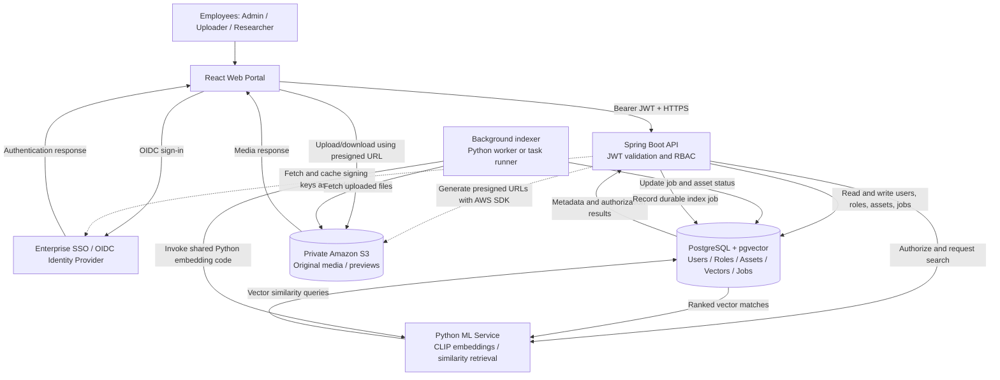
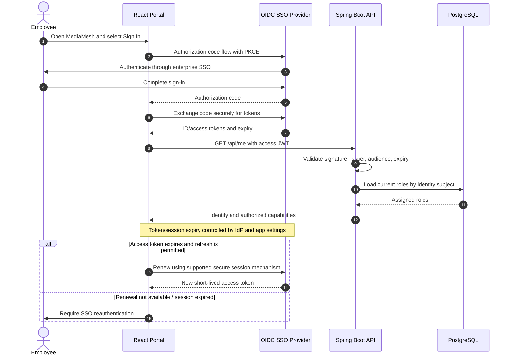
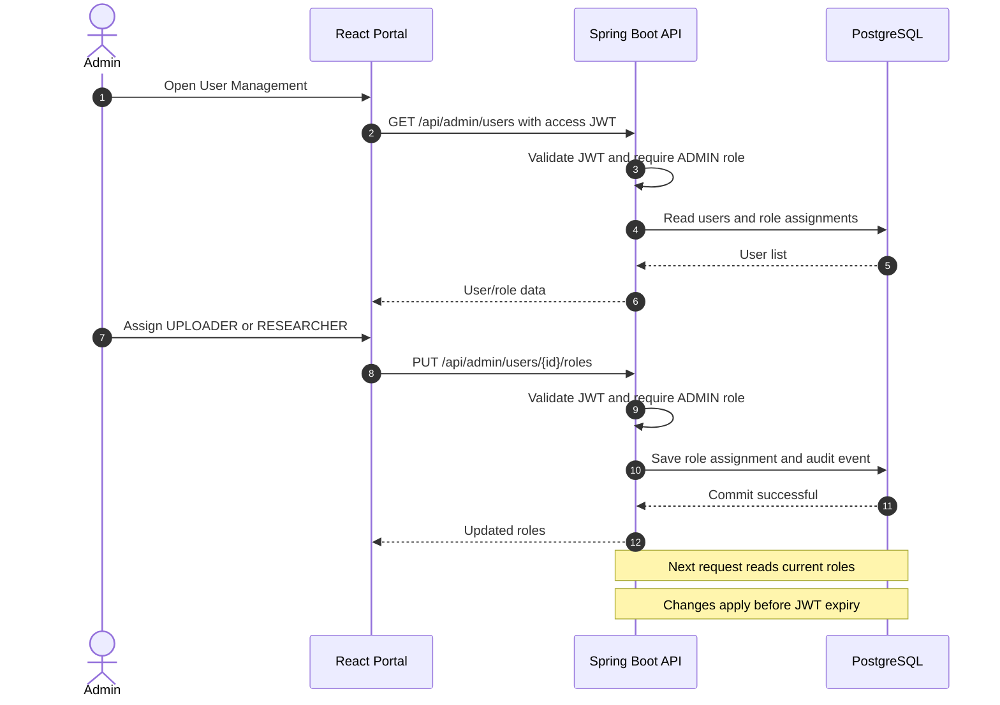
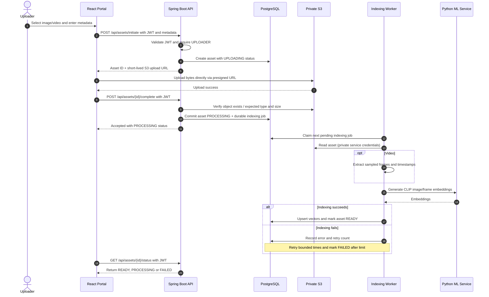
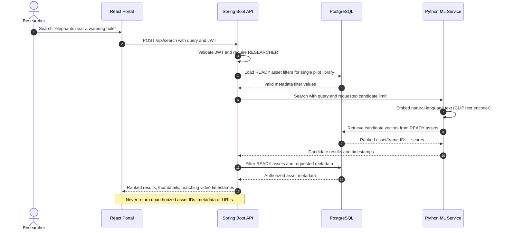
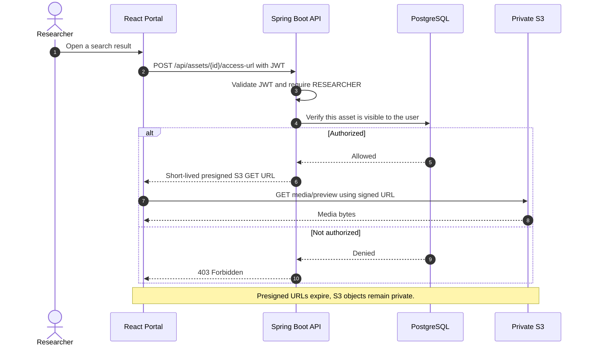
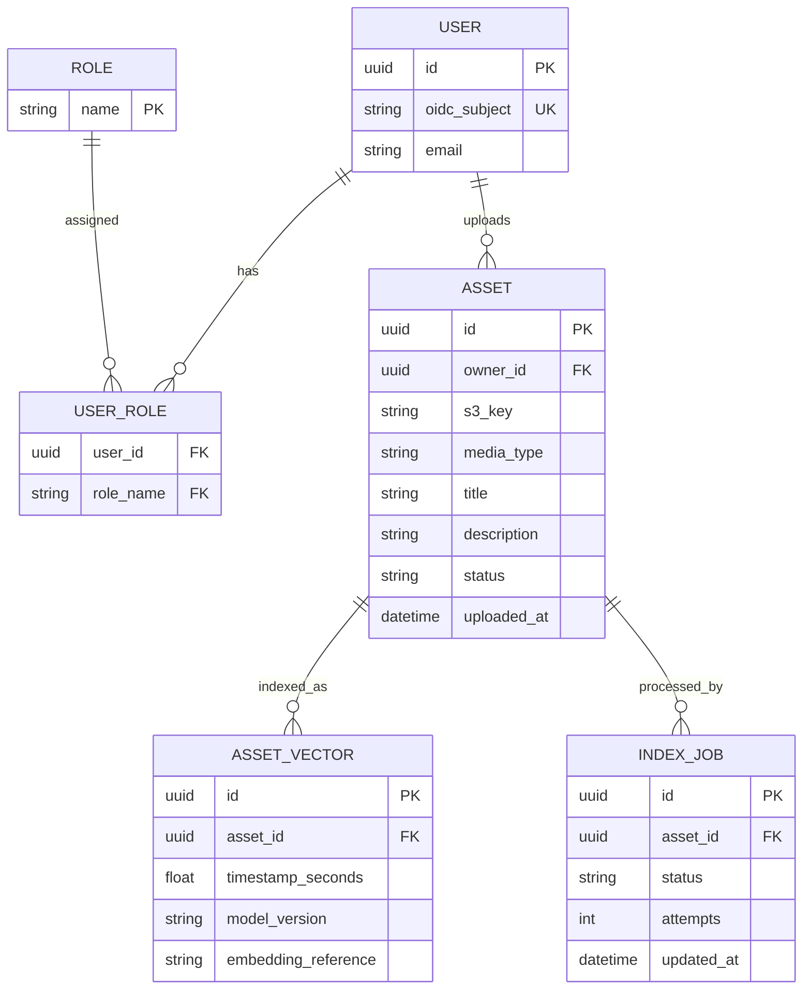

# MediaMesh — Enterprise Media Discovery Platform

**Solution design proposal | Stakeholder review | Version 0.3 | 8 November 2026**  
**Illustrative organization:** National Geographic (NatGeo-style use case; not an actual NatGeo integration)  
**Status:** Proposed architecture — pending approval of the decisions in Section 11. This is the authoritative MVP design; the companion background document is non-normative.

## 1. Executive summary

MediaMesh is a secure internal media library where authorized employees upload photographs and videos, while authorized researchers use natural-language queries to locate relevant assets. An administrator assigns application roles. Employees authenticate through enterprise single sign-on (SSO); APIs validate JWT access tokens and enforce role-based access control (RBAC). Original files are held privately in Amazon S3. Metadata and vector embeddings are stored in PostgreSQL with pgvector. A standalone Python ML service provides CLIP-based multimodal embeddings, video-keyframe indexing, and semantic similarity retrieval.

**MVP objective:** Demonstrate one complete, secure enterprise workflow: **SSO → admin role assignment → authorized media upload → automatic indexing → authorized semantic search → secure preview/download**.

The goal is **minimum implementation effort**, not a custom distributed storage system or a broad AI platform. S3 provides managed object storage; no custom replication, Kafka, Kubernetes, service mesh, or agent framework is required for the MVP.

## 2. Business problem and expected outcome

**Example scenario.** A NatGeo media researcher needs pictures or clips showing “elephants walking near a watering hole.” Searching filenames and manually maintained tags is slow and misses relevant assets. MediaMesh retrieves visually similar content while enforcing the permissions assigned by an administrator.

**Business outcomes:**
- Reduce time spent finding relevant visual media.
- Centralize access to approved media and ownership metadata.
- Ensure only permitted employees can upload, search, preview and download assets.
- Provide a clear path from upload to searchable asset, including failure status and retry.

**Primary users:** Administrator, Media Uploader, Media Researcher. A single employee may hold more than one role. Users with no assigned role may authenticate but cannot use protected business operations.

## 3. MVP scope and explicit exclusions

| In scope (required for demo) | Out of scope (defer unless approved) |
|---|---|
| Federated OIDC SSO and JWT-protected API | Building a custom identity provider |
| Admin-managed Uploader/Researcher roles | Complex organization-wide IAM workflows |
| Private S3 uploads, previews and downloads | Custom distributed file replication |
| Image semantic search with CLIP-compatible text/image embeddings | LLM agents, Ollama, MCP workflow orchestration |
| Video search through selected keyframes and timestamps | Native temporal video-understanding model |
| Asset metadata, status and access rules in PostgreSQL | Multi-tenant SaaS and elaborate per-asset ACL policy engine |
| Content-similarity recommendation (“Related media”) | Personalized collaborative filtering |
| Basic health checks, error handling and CI tests | Kafka, Kubernetes and service mesh |

**Audio:** Audio-content search and audio ingestion are deferred. The MVP accepts photographs and short video clips only, keeping the upload/indexing contract consistent with the team assignments.

**Authorization choice for minimum effort:** Roles control operations globally. Restrict access to assets by owner/collection visibility only if a restricted-collection demonstration is a stakeholder requirement. Otherwise start with a single internal media library where all Researcher-role users can view approved assets.

## 4. Proposed logical system architecture

This is the source-of-truth architecture for the MVP. Implementations must follow the API contract in Section 8 and the shared team overview. The background document explains decisions only.



**Deployment interpretation:** These are logical responsibilities, not necessarily separate microservices. The ML inference code and indexing worker may run from the same Python codebase. React, Spring Boot, Python and PostgreSQL can run in Docker Compose locally; S3 and the SSO provider are managed external services.

### Component responsibilities

| Component | Owns | Does not own |
|---|---|---|
| Identity provider | Employee authentication, SSO, OIDC protocol, token issuance | MediaMesh roles and media authorization |
| React portal | Login redirect, upload and search UI, result presentation | Security enforcement |
| Spring Boot API | JWT validation, role checks, asset lifecycle, presigned URLs, result authorization | Large binary file transfer or ML inference |
| PostgreSQL + pgvector | User-role assignments, media metadata, processing jobs, vectors | Original media bytes |
| S3 | Private object storage, managed durability | Semantic similarity search |
| Python ML | Image/text embedding, keyframe processing, vector similarity, related items | Assigning user roles |

## 5. Roles and access model

| Action | Admin | Uploader | Researcher | Unassigned employee |
|---|:---:|:---:|:---:|:---:|
| View/manage user-role assignments | Yes | No | No | No |
| Upload media | Optional* | Yes | No | No |
| Edit own media metadata | Optional* | Yes | No | No |
| Search media | Optional* | No | Yes | No |
| Preview/download search results | Optional* | No | Yes | No |

*For least privilege, **Admin is not implicitly a content user**. An admin can explicitly assign themselves Uploader or Researcher roles if needed. The table intentionally keeps administrative powers separate from content operations.

**Access rule:** Every protected API endpoint validates identity *and* current effective roles. UI visibility is convenience only. Role assignment/revocation persists in the application database and is checked for every request, so a long-lived JWT containing old roles does not override a revocation. JWT contains identity and standard security claims; application roles remain authoritative in PostgreSQL.

## 6. Primary sequence diagrams

### Flow A — Employee SSO login, JWT APIs and session expiry



**Security decisions:** OIDC Authorization Code + PKCE with a supported SPA client library; short-lived access JWTs; signature, `iss`, `aud`, and `exp` validation in Spring Security; tokens kept in memory rather than localStorage. Renewal follows the selected identity provider's supported secure session flow. Application logout clears local credentials and requests IdP logout as supported. The proposed 15-minute access token, 30-minute idle limit, and 8-hour maximum login session are targets to approve and test, not guaranteed library defaults. Check RBAC against the database on every protected operation.

### Flow B — Administrator assigns or revokes a role



**Failure behavior:** A user without `ADMIN` gets HTTP `403`. Missing/expired/invalid JWT gets HTTP `401`. Admin cannot grant arbitrary unsupported role names.

### Flow C — Media upload and semantic indexing



**Reliability choice:** A minimal **database-backed indexing job**, not a volatile in-process callback, prevents lost work after restart without introducing SQS. Each job is idempotent by asset ID + model version. Support manual retry for `FAILED` assets. Set file-type/size limits, use private buckets and reject unexpected content.

### Flow D — Authorized natural-language semantic search



**MVP retrieval:** Researcher role grants access to all READY assets in the one pilot library. PostgreSQL metadata filters are applied by the API after vector retrieval; to reduce missed matches, the ML service should request more candidates than the final result limit. Strict filtered top-K search can be added later. CLIP-compatible text and image embeddings are in the same space. Images have one or more vectors; videos are indexed using a limited number of keyframes. The standalone Python ML service encodes natural-language queries and stored images using a compatible CLIP model, ranks candidates via pgvector, and returns only asset IDs, scores, and frame timestamps to the Spring Boot API. A user can request **related media** by searching with the chosen asset's embedding.

### Flow E — Authorized preview/download, expiration and denial



**Important limitation:** An already issued S3 presigned URL can remain usable until its short expiry even if an admin revokes access moments later. Keep expiry brief and do not expose URLs to unrelated users. Stronger immediate revocation would require proxying content through a permission-checking service, which is outside this MVP.

## 7. Minimal data model



The `embedding_reference` label represents the PostgreSQL `vector` column, whose exact dimensions and model version will be fixed in the ML migration; it is shown as a string in this conceptual ER diagram for broad Mermaid compatibility. For the lean MVP, roles are application-managed; user authentication remains managed by the IdP. Add `collection_id` and collection membership/visibility data **only if** restricted collections are approved as required scope. Avoid implementing asset-specific grants and multi-tenancy by default.

## 8. Standalone multimodal semantic retrieval service

The Python ML service is a **standalone MediaMesh component** built for the NatGeo-style media library. It exposes internal endpoints to the Spring Boot API and runs a background worker to index uploaded media. The browser cannot invoke the ML API directly.

| Component | MVP responsibility |
|---|---|
| Python Flask API | Implement internal semantic search and optional related-media retrieval |
| CLIP-compatible model | Generate text and image embeddings in one shared vector space |
| FFmpeg keyframe extractor | Sample a limited number of frames from short video clips and record timestamps |
| PostgreSQL + pgvector | Persist versioned asset/frame vectors and run similarity queries |
| Background indexing worker | Claim durable jobs, fetch media privately from S3, upsert vectors, and update processing status |
| Ranking and retrieval | Return ranked asset IDs, similarity scores, and optional video timestamps |

### Public API contract (Spring Boot)

| Endpoint | Required role | Responsibility |
|---|---|---|
| `GET /api/me` | Signed-in employee | Current profile and application roles |
| `GET /api/admin/users` | `ADMIN` | List users and their roles |
| `PUT /api/admin/users/{id}/roles` | `ADMIN` | Replace a user's roles and audit change |
| `POST /api/assets/initiate` | `UPLOADER` | Record media metadata and issue presigned S3 PUT URL |
| `POST /api/assets/{id}/complete` | `UPLOADER` and asset owner | Verify upload and queue indexing job |
| `GET /api/assets/{id}` | Appropriate upload/search permission | Return metadata and processing state |
| `GET /api/assets/{id}/status` | `UPLOADER` and asset owner, or `RESEARCHER` | Return asset processing state |
| `POST /api/search` | `RESEARCHER` | Semantic search and optional metadata filters |
| `POST /api/assets/{id}/access-url` | `RESEARCHER` | Authorize and issue short-lived S3 GET URL |

Unauthorized or expired token: `401`. Authenticated but insufficient role: `403`. Internal ML endpoints are never browser accessible.

### Internal ML contract

`POST /internal/search` accepts a natural-language query and requested result limit. It returns only ranked candidates; it does not issue public media links or decide user roles.

```json
{
  "query": "elephants drinking at a watering hole at sunset",
  "limit": 20
}
```

```json
{
  "matches": [
    {"assetId": "example-asset-id", "score": 0.83, "frameTimestampSeconds": 72},
    {"assetId": "example-image-id", "score": 0.79, "frameTimestampSeconds": null}
  ]
}
```

The Spring Boot endpoint `POST /api/search` performs JWT and role validation, calls the internal ML endpoint, and performs a final authorized asset and metadata lookup before returning results to the user. The ML endpoint stays private. **No existing external recommendation engine is a documented project dependency.**

### Model and indexing constraints

- Use one explicitly versioned compatible CLIP text/image model and record embedding dimensionality in configuration and migrations.
- Generate one vector for an image and separately indexed timestamped keyframes for videos.
- Support idempotent reindexing by asset, model version, and frame position.
- Keep only a small evaluation set of images/videos for the MVP; avoid native audio embeddings and expensive video understanding.
- Teammate 2 owns asset metadata and indexing-job schema; Teammate 3 owns vectors, ML inference, and worker execution. Agree on job claiming and state transitions before integration.

## 9. Security, failure handling and operating assumptions

- **Identity:** Use one OIDC-capable SSO provider; no password database in MediaMesh.
- **JWT:** Validate signed access tokens on every protected API; reject expired tokens with `401`.
- **RBAC:** Persist role assignments centrally; enforce on each business endpoint (`403` if authenticated but unauthorized).
- **Session:** Use the IdP-supported SPA OIDC Authorization Code + PKCE flow for the MVP, with JWTs held in memory. Propose a 15-minute access token, 30-minute inactivity threshold, and 8-hour maximum login session; validate enforceability against the chosen provider and client before promising these limits in the demo. No custom refresh-token service or localStorage token persistence.
- **Storage:** S3 bucket is private, with least-privilege IAM credentials and presigned URLs for time-limited client access.
- **Metadata:** Store S3 keys, ownership, statuses and versioned embeddings; avoid storing binary media in PostgreSQL.
- **Processing:** Durable database jobs, bounded retries, idempotent indexing and visible processing errors.
- **Observability:** Structured logs, API health checks and minimal audit events for role changes and media actions.
- **Deployment:** Docker Compose for local development and demonstration; managed S3/identity services. Jenkins builds and tests on GitHub changes.

## 10. Minimum acceptance criteria

| Scenario | Acceptance criterion |
|---|---|
| Employee signs in | Enterprise SSO completes; API accepts valid JWT and rejects expired/invalid JWT (`401`). |
| Admin assigns role | Only Admin can grant/revoke roles; updated privileges take effect on subsequent calls. |
| Unauthorized upload/search | Authenticated user lacking required role receives `403`. |
| Authorized upload | Image/video stored privately in S3; metadata persisted and indexing status visible. |
| Semantic image search | Natural-language query returns relevant indexed images from a curated evaluation set. |
| Semantic video search | Query returns relevant video and representative matching timestamp/keyframe. |
| Secure media retrieval | Only authorized users receive short-lived media URLs; S3 bucket is not public. |
| Background job failure | Failed indexing is visible and can be retried without duplicate asset records. |
| Engineering workflow | Services run via documented Docker setup; CI runs builds and tests. |

**Suggested demonstration:** Admin grants Uploader and Researcher roles; Uploader adds wildlife images and a short clip; indexing completes; Researcher searches “elephants near a watering hole” and previews matches; unassigned user is denied search; demonstrate expired JWT and revoked role handling.

## 11. Decisions requested from stakeholders

| Decision | Recommended MVP default | Alternative / impact |
|---|---|---|
| Is NatGeo illustrative or the actual client? | Illustrative scenario with sample or licensed content | Actual integration requires enterprise approval, legal/data review |
| Role separation | Admin, Uploader, Researcher; multiple roles per user | Combining roles simplifies UI but weakens demonstration |
| Asset visibility | All approved internal assets searchable by Researchers | Restricted collections add a permissions data model and tests |
| SSO provider | One supported OIDC provider, ideally existing team access | Deploying Keycloak adds local infrastructure |
| Session behavior | SPA OIDC with short-lived JWT; proposed 15m access, 30m idle, 8h absolute | Confirm enforcement with selected IdP; BFF is deferred |
| Media scope | Image semantic search + video keyframes | Native audio semantics and detailed video models are deferred |
| Vector storage | PostgreSQL + pgvector | FAISS requires separate persistence/permissions integration |
| Indexing reliability | Database-backed job table | SQS adds AWS infrastructure and operational setup |
| Deployment | Docker Compose + S3 + hosted IdP | Cloud deployment separately if specifically graded |
| CI/CD | GitHub + Jenkins pipeline | Other CI services only if course permits |

**Recommendation:** Approve the MVP above, select a single SSO provider and verify the proposed expiry behavior. Restricted collections are excluded unless specifically required. Existing teammate workstreams can proceed after the shared API and job contracts are confirmed.

## 12. Non-goals and project success boundary

MediaMesh is **not** rebuilding S3, training a multimodal foundation model, building a generalized autonomous agent, or delivering a production-grade National Geographic integration. It is a demonstrable enterprise-style application built around managed identity, role-enforced APIs, secure media storage and a standalone multimodal semantic retrieval service.

**MVP is complete when the end-to-end demonstration works securely, is reproducible, and meets the acceptance criteria in §10.**
