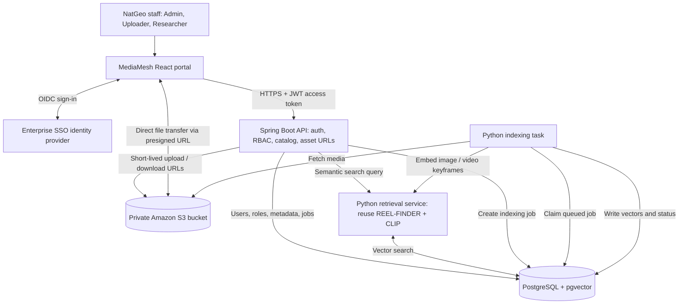
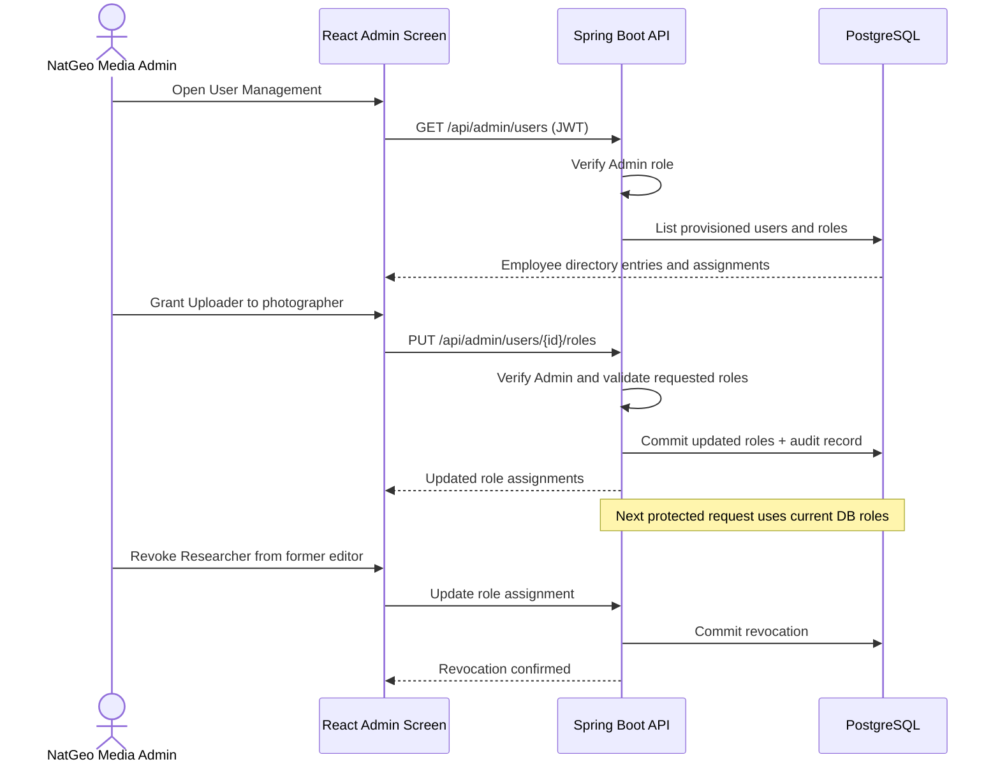
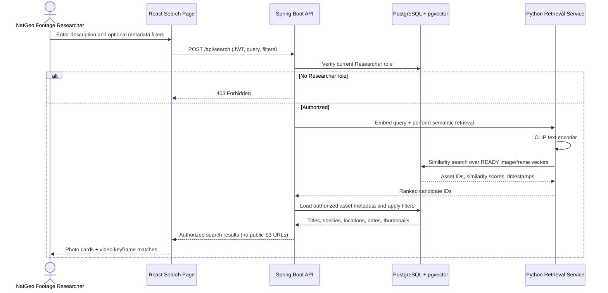
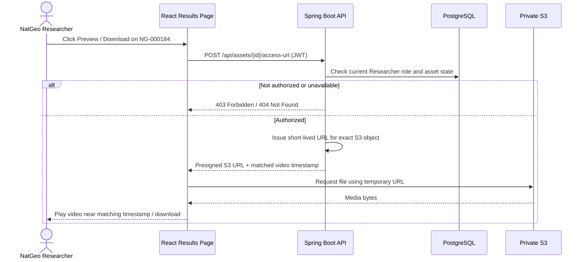

# MediaMesh for National Geographic — Stakeholder Design Proposal

**Version:** 0.2 | **Status:** For scope approval | **Date:** 7 November 2026  
**Customer scenario:** A *hypothetical* National Geographic (NatGeo) editorial media library; this is a proposed student-project use case, not a description of NatGeo's actual internal software, security policies, or workflows.

## 1. Decision we are asking stakeholders to make

**Approve a lean MVP:** A secure internal library in which NatGeo media contributors upload wildlife photos and documentary clips; NatGeo footage researchers describe what they need in plain English and find relevant assets; and a NatGeo Media Administrator grants/revokes **Uploader** and **Researcher** access. All employees sign in through enterprise SSO. Files live in S3, and an adapted version of REEL-FINDER powers semantic retrieval.

**The demonstrable outcome:** A researcher preparing a wildlife article can find the right photo or moment in a documentary clip without knowing its filename, and a user without Researcher access cannot search or retrieve that asset even by calling an API directly.

### Concrete pilot scenario

A photo editor is preparing a feature on **elephants during the dry season**. The NatGeo library contains images from multiple shoots and a short documentary clip whose filename is `DSC_0842.mp4`. The researcher searches:

> **“Elephants drinking at a watering hole at sunset.”**

MediaMesh retrieves visually related photographs and, if a video keyframe matches, a preview that opens at the approximate video timestamp. The researcher can inspect the **species**, **shoot location**, **capture date**, **photographer**, and **usage-rights note** that the uploader entered. A valid Researcher role is required to search, preview or download.

The model searches **visual content**; it does *not* guarantee factual recognition of exact locations, capture dates or licensing rights. Those are explicit metadata fields.

## 2. NatGeo employees and permissions

| Actor | Realistic responsibility in this pilot | What they do in MediaMesh |
|---|---|---|
| **Media Administrator** | Onboard and offboard editorial staff | Find a signed-in employee and assign/revoke Uploader or Researcher roles; inspect who has access |
| **Media Uploader** (photographer / archive assistant) | Add new field photos and documentary footage | Upload images/videos and enter/edit source information and rights notes |
| **Media Researcher** (editor / footage researcher) | Find assets for articles or production | Enter natural-language queries, filter on metadata, preview and download assets |
| **Signed-in, unassigned employee** | Staff member without library permission | Can log in but receives access-denied responses for upload/search/download |

**RBAC decision:** Admin controls role grants. Admin privileges do **not** automatically grant upload or search permissions; a person can hold multiple roles when needed. We require only **three roles** and **one organization** for the MVP. We are *not* building per-project approval workflows or a full digital-rights management product.

| Operation | Admin | Uploader | Researcher | Unassigned |
|---|:---:|:---:|:---:|:---:|
| Assign / revoke user roles | Yes | No | No | No |
| Upload photo or video | With Uploader role | Yes | No | No |
| Edit owned asset metadata | With Uploader role | Yes | No | No |
| Natural-language search | With Researcher role | No | Yes | No |
| Preview / download an asset | With Researcher role | No | Yes | No |

**Editorial access assumption for MVP:** Every indexed asset belongs to one internal searchable library and can be viewed by users with the Researcher role. This avoids designing restricted collections in v1. If stakeholders require confidential, embargoed or externally licensed content with different access groups, that becomes a **separate scope decision** and needs asset/collection-level authorization before such files are ingested.

## 3. NatGeo-specific asset and search requirements

### Asset record (one photo or documentary video)

| Field | Example | Purpose |
|---|---|---|
| Asset ID | `NG-000184` | Stable internal reference |
| Original file | `DSC_0842.mp4` | S3 object reference; never rely on filename as a search key |
| Title | `Elephant herd at Okavango watering hole` | Human-readable catalog title |
| Description / shot notes | `Elephants gather near water at sunset` | Text search / editorial context |
| Media type | `video` | Image vs video treatment |
| Species / subject | `African elephant` | Structured metadata filter |
| Location | `Okavango Delta, Botswana` | Uploader-supplied location filter |
| Capture date | `2025-08-14` | Uploader-supplied date filter |
| Photographer / crew | `NatGeo field contributor` | Attribution |
| Rights / usage note | `Internal editorial review; verify license before publication` | Informs human editorial review; **not** automated rights clearance |
| Processing state | `UPLOADING / PROCESSING / READY / FAILED` | Shows whether media is searchable |
| Video frame timestamps | `00:01:12`, `00:02:18` | Opens video near a matched keyframe |

### MVP search experience

- **Natural language:** “Snow leopard on a rocky ridge” returns visually similar images and video moments, including assets with unhelpful filenames.
- **Structured filters:** Apply species, media type, location and date **only when these metadata values exist**. A query such as “lions in Kenya after 2022” should combine visual similarity with location/date filtering, not pretend the model inferred exact provenance.
- **Result cards:** Show thumbnail, title, media type, location, capture date, attribution and link to preview.
- **Related media:** An optional “Find similar” action searches the same embedding index, without a new personalization system.
- **Preview/download:** Spring Boot checks the Researcher role and issues short-lived S3 presigned URLs; S3 objects are not public.

**MVP media support:** Images have text-to-image semantic retrieval. Videos are represented by sampled frames, so they support *approximate visual-moment retrieval*. Audio files, speech transcription, native temporal video understanding and rights clearance are **out of scope** for the MVP.

## 4. Proposed architecture — deliberately small



**Implementation boundary:** The Python indexing task and Python retrieval service can share a repository and image. No separate Kafka, SQS, Kubernetes, service mesh or custom distributed-storage engine is required. Keep S3 private and use its managed durability.

## 5. Sequence diagrams — actual NatGeo user journeys

### Flow A — Staff SSO login, JWT access and expiry

**Example:** A NatGeo footage researcher opens the portal. Authentication proves their identity; MediaMesh separately checks whether they hold the Researcher role.

```mermaid
sequenceDiagram
    actor R as NatGeo Employee
    participant W as React Portal
    participant I as Enterprise IdP (OIDC)
    participant B as Spring Boot API
    participant D as PostgreSQL
    R->>W: Open MediaMesh
    W->>I: Redirect for SSO (OIDC Authorization Code + PKCE)
    I-->>W: Complete sign-in and establish app session
    W->>B: GET /api/me with access JWT
    B->>B: Validate JWT signature, issuer, audience, expiry
    B->>D: Look up user and current role assignments
    D-->>B: Researcher role (or no assigned role)
    B-->>W: Authenticated profile + permitted actions
    Note over W,B: JWT is short-lived; app session has idle/absolute expiry
    R->>W: Later request after access token expires
    W->>B: API call with expired JWT
    B-->>W: 401 Unauthorized
    W->>I: Renew via supported secure session flow, or reauthenticate
    Note over W,I: Logout ends local session; IdP logout depends on provider
```

**MVP security defaults to approve:** 15-minute access JWT; application idle timeout of 30 minutes; maximum application session of 8 hours; secure renewal handled by the chosen OIDC library/provider. Prefer secure HttpOnly cookies for server-managed session/renewal material; do not keep long-lived refresh tokens in browser localStorage. A revoked role is read from PostgreSQL on protected requests instead of trusting stale role claims in JWTs.

### Flow B — Admin grants / revokes employee roles

**Example:** The NatGeo archive manager gives a photographer Upload access and a video editor Research access.



Provision a user record when the person first logs in through SSO. For the MVP, admins assign roles to **already provisioned users**; automatic sync of every NatGeo directory user is unnecessary.

### Flow C — Photographer uploads and indexes wildlife footage

**Example:** An authorized uploader adds `DSC_0842.mp4`, titles it “Elephant herd at watering hole,” and records location, capture date and usage notes.

```mermaid
sequenceDiagram
    actor U as NatGeo Media Uploader
    participant W as React Upload Screen
    participant B as Spring Boot API
    participant D as PostgreSQL
    participant S as Private S3
    participant J as Python Indexing Task
    participant M as ML / CLIP
    U->>W: Choose video, enter species, location, rights note
    W->>B: POST /api/assets/initiate (JWT + metadata)
    B->>D: Check Uploader role; create asset UPLOADING
    B-->>W: Asset ID + scoped, expiring S3 upload URL
    W->>S: PUT original file directly to S3
    S-->>W: Upload succeeded
    W->>B: POST /api/assets/{id}/complete
    B->>S: Verify object exists and expected details
    B->>D: Set PROCESSING + persist indexing job
    B-->>W: 202 Accepted; show Processing
    J->>D: Claim pending job
    J->>S: Read private media
    J->>J: Extract representative video keyframes
    J->>M: Generate image/frame embeddings
    M-->>J: Embeddings
    J->>D: Save vectors, timestamps; set READY
    W->>B: GET /api/assets/{id}
    B-->>W: READY / FAILED processing status
    Note over J,D: Failed jobs stay visible and can be retried
```

**Scope cut:** Do not route large video bytes through Spring Boot. The uploader sends directly to S3. For MVP resilience, the Python worker polls a PostgreSQL jobs table; this is simpler than introducing a queueing service. Jobs need retry counts and a recoverable lease/timeout to prevent permanently stuck `PROCESSING` assets.

### Flow D — Footage researcher performs natural-language search

**Example:** An editor searches **“Elephants drinking at a watering hole at sunset”** and optionally filters to Botswana and video assets.



**Search truthfulness:** Visual similarity ranks candidate assets; title, species, location and date come from submitted metadata. Do not market inferred location/date as verified facts.

### Flow E — Researcher previews or downloads selected media

**Example:** The researcher opens an elephant video at the returned approximate timestamp and downloads the original for editorial review.



**Important:** Presigned URLs remain usable until their own expiration even after a role is revoked. Use a short expiration (proposed: **60 seconds**) and issue URLs only after current authorization. A time-limited URL is not instantaneous revocation.

## 6. Minimum data model

| Table | Fields needed for this NatGeo pilot |
|---|---|
| `users` | `id`, `oidc_subject`, `email`, `display_name` |
| `user_roles` | `user_id`, `role` (ADMIN / UPLOADER / RESEARCHER), `assigned_by`, `assigned_at` |
| `assets` | `id`, `owner_id`, `s3_key`, `media_type`, `title`, `description`, `species`, `location`, `captured_at`, `contributor`, `usage_note`, `processing_status` |
| `asset_vectors` | `asset_id`, `frame_timestamp_seconds` (nullable for photos), `model_version`, `embedding` |
| `index_jobs` | `asset_id`, `status`, `attempts`, `last_error`, `lease_until` |
| `audit_events` | `actor_user_id`, `action`, `target_id`, `timestamp`, `outcome` (especially role changes and downloads) |

A small audit table is worth retaining for enterprise credibility; a full SIEM integration is not necessary. Avoid recording sensitive search text or secrets in audit records.

## 7. Reuse REEL-FINDER rather than rebuilding search

| REEL-FINDER capability | NatGeo adaptation | Decision |
|---|---|---|
| Python retrieval service | Maintain as MediaMesh ML service | **Reuse** |
| Sentence Transformers inference pattern | Use a compatible multimodal CLIP text/image encoder | **Adapt** |
| Vector similarity and ranking | Search asset/frame embeddings, return stable asset IDs | **Reuse approach** |
| FAISS indexing | Proof-of-concept possible; pgvector preferred for app persistence | **Replace for integrated MVP** |
| Movie titles, ratings, genres | NatGeo species, location, capture date and rights notes | **Replace domain data** |
| Personalized movie recommendations | Similar visual media from the same embeddings | **Simplify** |
| Ollama agent / FastMCP | Not needed to search visually by text | **Defer** |

**Critical modeling constraint:** Existing movie-text MiniLM vectors cannot be compared directly to CLIP image vectors. Re-embed NatGeo visual assets and their text queries using compatible encoders from the same multimodal model family.

## 8. Build order and acceptance criteria

| Phase | Minimum working result | Evidence for stakeholder demo |
|---|---|---|
| **1. Semantic proof** | Existing Python service embeds 20 wildlife photos; text query finds matches | Search “elephant at watering hole” without filename tags |
| **2. Catalog + S3** | Upload photo/video to private S3; persist metadata; auto-index image/video frames | Upload `DSC_0842.mp4`, see PROCESSING then READY |
| **3. Enterprise security** | OIDC SSO, Admin grants roles, JWT validation, expiration | Unassigned user fails search; admin grants Researcher; request succeeds |
| **4. End-to-end polish** | React upload/search results, preview/download, CI tests, basic failure recovery | Full editor journey and one failed/retried indexing job |

### Demo pass/fail checklist

- [ ] A new SSO-authenticated employee has **no** default upload/search access.
- [ ] Admin grants Uploader or Researcher role; only then can the corresponding API be called.
- [ ] Expired JWT is rejected with `401`; valid JWT without permission receives `403`.
- [ ] A contributor uploads `DSC_0842.mp4` directly to **private** S3 and supplies species/location/rights metadata.
- [ ] Image and extracted video-keyframe embeddings become searchable after processing.
- [ ] “Elephants drinking at a watering hole at sunset” finds related visuals without relying on the filename.
- [ ] Results show uploader-supplied provenance fields and approximate video timestamps.
- [ ] Preview/download URL is issued only to a currently authorized Researcher and expires quickly.
- [ ] Revoking Researcher prevents subsequent search and new URL issuance, even if the JWT is still valid.
- [ ] At least one indexing failure can be surfaced and retried; basic build/tests run in CI.

## 9. Decisions for the stakeholder meeting

| Decision | Lean proposal | What changes if rejected |
|---|---|---|
| **Target customer workflow** | Internal NatGeo-style wildlife editorial catalog | Redesign asset fields and user journeys if targeting public consumers or external licensing |
| **SSO provider** | One OIDC provider with a real federated SSO demonstration where feasible | Local dev provider can prove OIDC but is not itself proof of enterprise federation |
| **Permissions** | Three assigned roles; one searchable internal library | Confidential/embargoed collections require additional object-level authorization design |
| **Media scope** | Photos + video keyframe search | Audio transcription / temporal models increase ML workload |
| **Data / retrieval** | PostgreSQL + pgvector; private S3 | Alternative vector store or object store adds integration overhead |
| **Operational scope** | Docker Compose, one Python indexing worker, CI, retryable jobs | Managed event infrastructure / Kubernetes increases deployment work |
| **Rights metadata** | Display human-entered usage notes; human verifies publication eligibility | Automated license compliance is a separate project |

## 10. Explicitly excluded from the MVP

- Public NatGeo website integration, external publishing APIs or automatic publication approval.
- Per-asset legal rights enforcement, licensing marketplace, or content moderation engine.
- Confidential/embargoed media with per-project ACLs unless explicitly added as a requirement.
- Speech transcription, audio similarity search, detailed video-scene understanding.
- Multi-organization tenancy, custom S3 replication logic, Kafka, Kubernetes, service mesh or LLM agent.

**Proposed sign-off:** Approve the role matrix, sample editorial workflow, image/video semantic-search scope, SSO provider and single shared-library access assumption. Only then split tasks among teammates.
