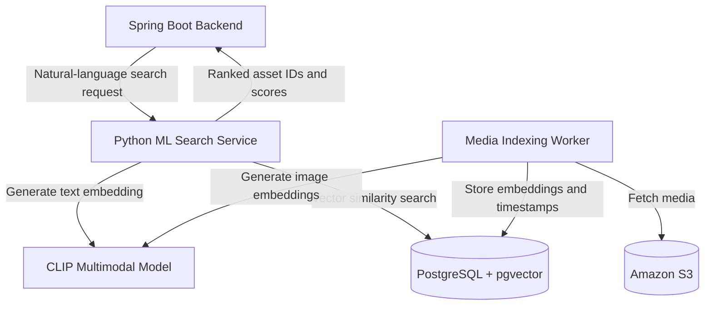
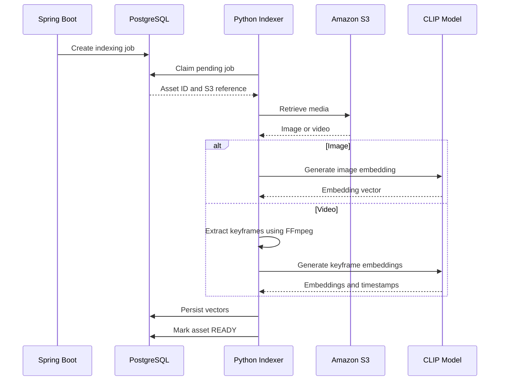

# Teammate 3 — Multimodal ML Service, Video Indexing and Semantic Search

**Mission:** Design and implement a standalone machine learning service for MediaMesh that enables National Geographic employees to discover wildlife photographs and documentary footage using natural-language queries.

The service will generate multimodal embeddings, index media content in PostgreSQL using pgvector, and retrieve relevant assets through vector similarity search. You will own the Python ML service, model inference, vector schema, indexing worker, and search/ranking logic.

**Out of scope:** Enterprise SSO, JWT authentication, RBAC, public Spring Boot APIs, S3 upload URL generation, and the React frontend.

## You own

- Entire `ml-service/` directory, including Python source code, dependencies, Dockerfile, configuration, and tests.
- SQL migrations `V3xx__...sql` for pgvector and the `asset_vectors` table.
- Multimodal embedding generation using a compatible CLIP text/image model.
- Image and video keyframe indexing.
- Background media-processing worker.
- Internal semantic search and similarity retrieval APIs.
- Lightweight evaluation dataset containing wildlife photographs and documentary footage.

## ML Service Architecture



The ML service runs independently from the Spring Boot backend and exposes internal APIs for semantic retrieval. The background worker handles media indexing after uploads are completed.

### Core components

| Component | Responsibility |
|---|---|
| Python Flask API | Internal semantic search and similarity endpoints |
| CLIP Model | Generate compatible text and image embeddings |
| PostgreSQL + pgvector | Persist and search media embeddings |
| FFmpeg | Extract representative frames from videos |
| Indexing Worker | Process uploaded media and update indexing status |
| Similarity Ranking | Return the most relevant matching assets |

## Tasks in implementation order

- [ ] **T3.1 — Develop the multimodal embedding pipeline.** Select one CLIP-compatible text/image embedding model using Sentence Transformers or an equivalent Python library. Generate embeddings for 20–30 sample wildlife images. Demonstrate that natural-language queries such as "elephants at a watering hole" retrieve relevant photographs. Document the model name, version, embedding dimensions, and inference requirements.

- [ ] **T3.2 — Design the vector database schema.** Enable pgvector in PostgreSQL and create the `asset_vectors` table containing `asset_id`, `frame_timestamp_seconds`, `model_version`, and the embedding vector. Reference teammate 2's `assets` table through a foreign key. Add appropriate indexes and uniqueness constraints to prevent duplicate embeddings. Do not modify the media metadata tables.

- [ ] **T3.3 — Implement image indexing.** Build a pipeline that accepts an asset ID and an accessible media reference, loads the image, generates its CLIP embedding, and stores the result in pgvector. Ensure repeat indexing updates existing records rather than creating duplicates. Support removal or replacement of outdated embeddings.

- [ ] **T3.4 — Implement video keyframe indexing.** Use FFmpeg to extract a small, configurable number of representative frames from short wildlife documentary clips. Generate an embedding for each frame and store its associated timestamp. This enables the search service to identify relevant moments within videos. Full video understanding and audio transcription are not required.

- [ ] **T3.5 — Develop the background indexing worker.** Implement a Python worker that processes indexing jobs created by the Spring Boot backend. The worker should claim an available job, retrieve the media from private S3 using server-side AWS credentials, generate embeddings, persist them, and update the asset to `READY`. Support retryable failures, attempt tracking, and safe job claiming to avoid duplicate concurrent processing. Teammate 2 owns the job schema and lifecycle APIs; you own the worker implementation.

- [ ] **T3.6 — Implement the semantic search API.** Expose `POST /internal/search`, accepting a natural-language query and result limit. Encode the query using the CLIP text encoder, perform vector similarity search, and return ranked matching asset IDs, scores, and video-frame timestamps. The API must not return S3 URLs or user information. Spring Boot remains responsible for public authorization and asset metadata filtering.

- [ ] **T3.7 — Implement similar-media recommendations.** Add an internal endpoint that retrieves visually similar assets using existing embeddings. This should reuse the same vector index and ranking logic without introducing behavioral personalization or additional recommendation models. Implement after core search is stable.

- [ ] **T3.8 — Add testing and performance validation.** Develop tests for embedding dimensions, indexing consistency, duplicate prevention, empty-index searches, video timestamps, and failed-job retries. Maintain a small evaluation dataset with at least five expected wildlife search queries. Document model startup time, indexing performance, and dependencies required to run the service.

## API Contract

### Semantic Search

**Endpoint:** `POST /internal/search`

**Request:**

```json
{
  "query": "elephants drinking at a watering hole at sunset",
  "limit": 20
}
```

**Response:**

```json
{
  "matches": [
    {
      "assetId": "uuid",
      "score": 0.83,
      "frameTimestampSeconds": 72
    },
    {
      "assetId": "uuid2",
      "score": 0.79,
      "frameTimestampSeconds": null
    }
  ]
}
```

For photographs, `frameTimestampSeconds` is `null`. For videos, it represents the approximate position of the matching frame.

The API returns search candidates only. Spring Boot validates researcher permissions, applies metadata filters, and provides authorized media access.

### Similar Media

**Endpoint:** `POST /internal/similar`

**Request:**

```json
{
  "assetId": "uuid",
  "limit": 10
}
```

**Response:** Ranked asset IDs, similarity scores, and optional video timestamps, using the same response structure as semantic search.

## Media Indexing Workflow



For processing failures, the worker must record the error and follow the agreed retry policy rather than silently marking the asset ready.

## Integration Boundaries

### Teammate 1 — Enterprise Security

- Owns OIDC authentication, JWT validation, RBAC, and user role management.
- The ML service does not authenticate individual NatGeo employees.
- The Python API must be accessible only through a private service network or authenticated service-to-service channel.

### Teammate 2 — Media Backend and S3

- Owns asset metadata, S3 upload/download APIs, and indexing job creation.
- Provides asset IDs, S3 references, and the indexing job schema.
- Calls the Python search API and enriches results with metadata.
- Enforces authorization before returning search results or media access URLs.

### Teammate 4 — Frontend and DevOps

- Owns React, Docker Compose integration, and Jenkins configuration.
- The frontend communicates only with Spring Boot public APIs.
- The Python ML service must provide a Dockerfile, documented environment variables, health endpoint, and repeatable test commands.

### Shared agreements required at Checkpoint A

- CLIP model and embedding dimensions.
- `asset_vectors` schema and foreign-key contract.
- `index_jobs` schema, status transitions, and retry semantics.
- Internal search API request and response formats.
- Environment-variable and service-network conventions.

Once these contracts are agreed, ML development can proceed independently using local test fixtures and mock asset references.

## Independent Demonstration

The ML service must be demonstrable before integration with the rest of MediaMesh.

1. Index a small collection of wildlife images into PostgreSQL with pgvector.
2. Search "elephants drinking at sunset" and display ranked matching images.
3. Index a short documentary clip and return a relevant frame timestamp.
4. Re-index the same asset and verify that duplicate records are not created.
5. Simulate one failed indexing job and demonstrate successful retry.
6. Run the search endpoint through its internal API and verify the response contract.

## Definition of Done

- [ ] Python ML service runs independently and is containerized.
- [ ] CLIP text and image embeddings use a compatible embedding space.
- [ ] Image embeddings and video keyframe embeddings persist in pgvector.
- [ ] Natural-language searches return ranked asset IDs and timestamps.
- [ ] Background worker processes uploaded S3 media using the agreed indexing contract.
- [ ] Repeated indexing does not create duplicate vectors.
- [ ] Failed jobs are recorded and can be retried.
- [ ] Internal semantic search endpoint is documented and tested.
- [ ] Service provides health checks and repeatable local setup instructions.
- [ ] Integration with Spring Boot is possible without modifying the ML service's internal implementation.

**Final deliverable:** A standalone, containerized Python ML service that supports multimodal media indexing and natural-language retrieval for National Geographic's enterprise media library.
